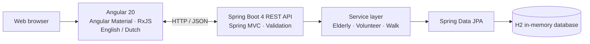
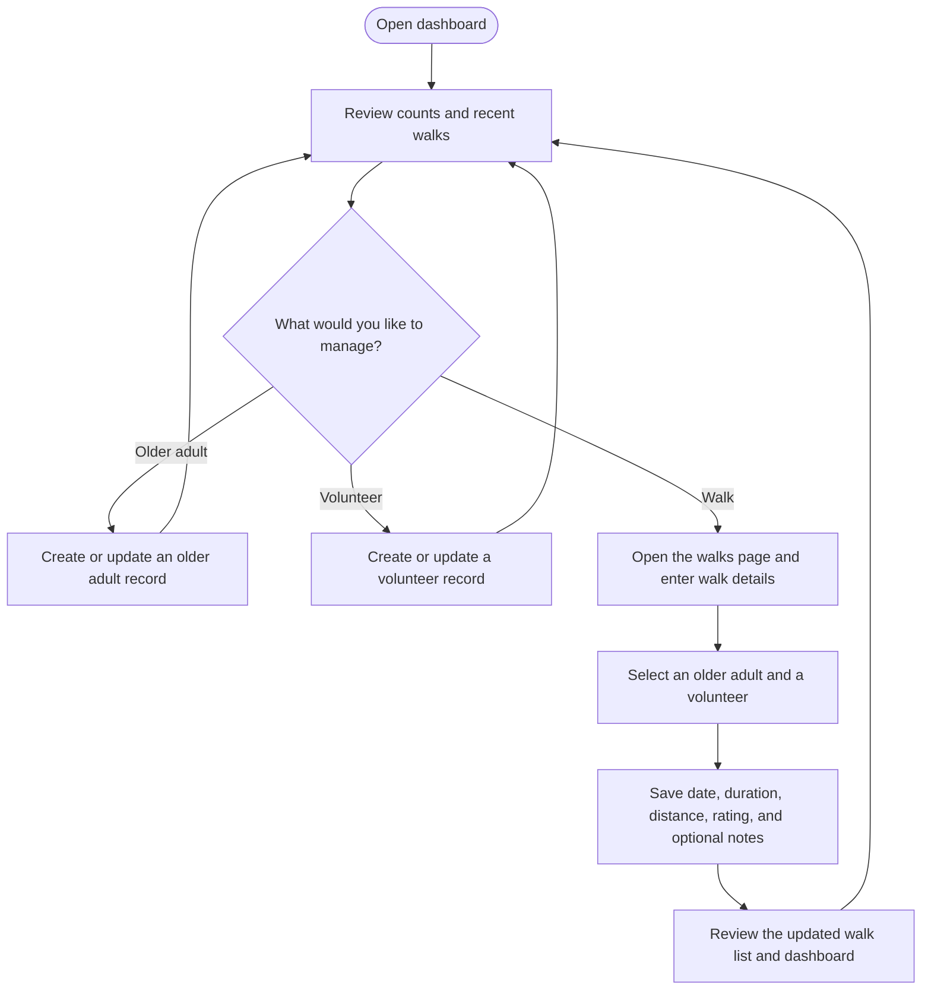

<div align="center">

# WandelMaatje

### Bringing older adults and volunteers together, one walk at a time.

**WandelMaatje** is a full-stack application for coordinating community walks. It helps organizers keep track of older adults, volunteers, and walk records in one place.

[Features](#features) · [Architecture](#architecture) · [Getting Started](#getting-started) · [API](#api)

</div>

---

## At a glance

- Manage older adult and volunteer records.
- Register walks and connect each one to an older adult and a volunteer.
- Track walk dates, duration, distance, a 1–5 pain/mood rating, and optional notes.
- View record totals and recent walks on the dashboard.
- Use the interface in English or Dutch, with a responsive layout.

## Visual preview

The images below are **design mockups**, included to illustrate the intended interface; they are not screenshots of a running application.

<div align="center">
  
  <p><em>Desktop dashboard concept</em></p>
</div>

<div align="center">
  
  <p><em>Tablet layout concept</em></p>
</div>

## Features

| Area | What you can do |
| --- | --- |
| Dashboard | Review totals for older adults, volunteers, and walks; see recent walks and quick links. |
| Older adults | Create, view, search, update, and delete records, including age, mobility level, and notes. |
| Volunteers | Create, view, search, update, and delete volunteer records. |
| Walks | Create, view, search, update, and delete walks linked to an older adult and a volunteer. |
| Language and layout | Switch between English and Dutch; use the responsive Angular interface on different screen sizes. |

## Architecture

The Angular single-page application communicates with the Spring Boot REST API using JSON over HTTP. The backend separates request handling, business logic, and data access. The current development configuration uses an in-memory H2 database initialized with sample data.



## Typical workflow



## Technology stack

| Layer | Technologies |
| --- | --- |
| Frontend | Angular 20, TypeScript, Angular Material, Bootstrap, RxJS, `ngx-translate` |
| Backend | Java 17, Spring Boot 4, Spring MVC, Spring Data JPA, Bean Validation |
| Development database | H2 in-memory database |
| API documentation | OpenAPI / Swagger UI |

## Getting Started

### Prerequisites

- Java 17 or newer
- Node.js 20.19 or newer and npm
- A browser

The backend includes the Maven Wrapper, so a separate Maven installation is not required.

### 1. Start the backend

From the repository root:

```bash
cd backend
./mvnw spring-boot:run
```

The API starts at `http://localhost:8080`. The H2 database is created in memory and populated with sample records at startup; **data is reset when the backend restarts**.

### 2. Start the frontend

In a separate terminal:

```bash
cd frontend
npm ci
npm start
```

Open `http://localhost:4200`. The development frontend is configured to call the API at `http://localhost:8080/api`.

### Optional: H2 console

The development H2 console is available at `http://localhost:8080/h2-console`.

| Setting | Value |
| --- | --- |
| JDBC URL | `jdbc:h2:mem:wandelmaatje` |
| User name | `sa` |
| Password | *(blank)* |

This in-memory database and console are for local development, not production use.

## API

The REST API is rooted at `/api`:

| Resource | Base path | Operations |
| --- | --- | --- |
| Older adults | `/api/elderlies` | List (paginated), search by name, get by ID, create, update, delete |
| Volunteers | `/api/volunteers` | List (paginated), search by name, get by ID, create, update, delete |
| Walks | `/api/walks` | List (paginated), search by older adult or volunteer, get by ID, create, update, delete |

Paginated list endpoints accept `page`, `size`, `sortBy`, and `direction` query parameters. When the backend is running, interactive API documentation is available at [`http://localhost:8080/swagger-ui/index.html`](http://localhost:8080/swagger-ui/index.html).

## Tests and build

Run backend tests from the `backend` directory:

```bash
./mvnw test
```

Run frontend tests from the `frontend` directory:

```bash
npm test -- --watch=false
```

Build the frontend:

```bash
npm run build
```

## Repository structure

```text
backend/     Spring Boot REST API, domain models, and tests
frontend/    Angular application and frontend tests
docs/ui/     Interface concepts, mockups, and design diagrams
```

## Contributors

- [Alan Soares](https://github.com/soares-alan)
